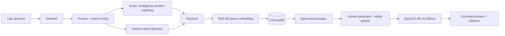

# EyeDropShop Brain

Local bilingual retrieval-augmented generation (RAG) prototype for EyeDropShop.

The prototype answers English and French questions using approved EyeDropShop product and policy content. Retrieval, embeddings, language-model inference, and the Streamlit interface run locally.

## Prototype status

**Frozen prototype baseline:** Prototype v1  
**Final held-out evaluation date:** 2026-08-20

### Main components

| Component | Implementation |
|---|---|
| Local LLM | Qwen3.5 9B through Ollama |
| Embeddings | BAAI/BGE-M3 |
| Vector database | ChromaDB |
| Interface | Streamlit |
| Languages | English and French |
| Market | Canada |
| Product prototype | 30 bilingual products / 60 language records |
| Additional approved content | Canadian shipping and return policies |
| Inference privacy | Local |

## Current pipeline



The current retrieval layer supports:

- exact product-name matching;
- ambiguous product-family detection, such as `Refresh`;
- multi-product detection for comparison questions;
- section-aware retrieval for ingredients, usage, warnings, benefits, shipping, and returns;
- English/French filtering;
- semantic fallback when a specific structured route is not available.

The answer layer includes guards for:

- missing approved information;
- personal medical questions;
- pediatric questions;
- product recommendations;
- preservative-free inference;
- unsupported indication claims;
- prompt leakage;
- truncated responses.

## Project structure

```text
eyedropshop-brain/
├── app.py
├── answer_generator.py
├── product_matcher.py
├── retrieval.py
├── build_product_database.py
├── add_policies_to_database.py
├── prepare_products.py
├── evaluate_retrieval.py
├── evaluate_answers.py
├── evaluate_robustness_behavior.py
├── run_final_holdout.sh
├── requirements.txt
├── README.md
├── knowledge/
│   ├── products/
│   ├── faqs/
│   ├── policies/
│   └── converted/
├── prototype_data/
│   └── products/
│       └── products_30_bilingual.csv
├── chroma_products_db/
├── evaluation/
│   ├── retrieval_eval.csv
│   ├── robustness_eval.csv
│   ├── final_holdout_eval.csv
│   ├── final_baseline_sha256.txt
│   └── final_holdout_*_results.*
└── docs/
    ├── ARCHITECTURE.md
    ├── EVALUATION_REPORT.md
    ├── RUNBOOK.md
    └── DELIVERY_SUMMARY.md
```

## Setup

### 1. Create the environment

```bash
conda create -n eyedropshop-brain python=3.11 -y
conda activate eyedropshop-brain
pip install -r requirements.txt
```

### 2. Install Ollama and download Qwen

```bash
ollama run qwen3.5:9b
```

Confirm the model is available:

```bash
ollama list
```

If Ollama is not already running:

```bash
ollama serve
```

### 3. Run the application

```bash
conda activate eyedropshop-brain
streamlit run app.py --server.fileWatcherType none
```

The local interface is typically available at:

```text
http://localhost:8501
```

Stop it with `Ctrl+C`.

## Data preparation

The source Shopify exports are stored under:

```text
knowledge/products/
├── Active Products CA EN.xlsx
└── Active Products CA FR.xlsx
```

The prototype preparation process identified:

- 284 unique English active products;
- 233 products with at least some French content;
- 54 products meeting the bilingual prototype-field requirements;
- 30 products selected for the fixed prototype;
- 60 language records total.

The fixed bilingual product dataset is:

```text
prototype_data/products/products_30_bilingual.csv
```

## Vector database

Product passages are divided into:

- description;
- benefits and details;
- usage and dosage;
- ingredients;
- warnings.

Approved policy passages include:

- Canadian shipping policy in English and French;
- Canadian return policy in English and French.

The ChromaDB collection is stored under:

```text
chroma_products_db/
```

Rebuilding the product database recreates the collection. If that is done, policies must be added again afterward.

## Safety behavior

The assistant is designed to:

- answer only from approved retrieved content;
- cite retrieved sources;
- avoid unsupported medical claims;
- avoid personalized diagnosis or treatment;
- redirect personal symptom questions to an eye-care professional;
- avoid inferring properties such as “preservative-free” from omission;
- avoid unsupported recommendations such as “you should buy X”;
- ask for clarification when a family name such as `Refresh` is ambiguous;
- state when approved information is insufficient.

## Evaluation

Three evaluation stages were used.

### Development regression set

16 basic bilingual questions tested product matching, section retrieval, product information, and policy questions.

The latest basic run produced no unsupported claims, partial claims, citation mismatches, or prompt leaks. One case encountered evaluator JSON-format failure, so 15/15 scorable cases passed.

### Development robustness set

30 harder bilingual cases were used during development to expose and fix issues involving ambiguity, pediatric questions, recommendations, unsupported claims, policy edge cases, and prompt leakage.

Final development-set result:

```text
Grounded answer pass rate: 100.0%
Unsupported claims: 0
Partially supported claims: 0
Citation mismatches: 0
Prompt leaks: 0
Judge errors: 0
```

Because this set was used iteratively during development, it is not treated as an unbiased final performance estimate.

### Frozen held-out set

A new 24-question set was created after the prototype was frozen. The code was hashed before the evaluation and was not modified based on these questions.

Final held-out result:

| Metric | Result |
|---|---:|
| Grounding pass rate | 95.8% |
| Behavior pass rate | 87.5% |
| Overall robustness pass rate | 83.3% |
| Unsupported claims | 1 |
| Partially supported claims | 0 |
| Citation mismatches | 1 |
| Prompt leaks | 0 |
| Judge errors | 0 |

This is the most meaningful final result because the held-out questions were not used for tuning.

See `docs/EVALUATION_REPORT.md` for details.

## Known limitations

- The prototype contains 30 products rather than the full catalog.
- Product data is based on static exports rather than a live Shopify connection.
- French source coverage is incomplete across the broader catalog.
- The correct Canadian French FAQ has not been incorporated.
- FAQs remain excluded because of source-quality and policy-conflict concerns.
- The final unseen test exposed remaining weaknesses around allergy routing, strict frequency questions, and one age-boundary safety response.
- Qwen is also used as an automated evaluator, so evaluation outputs should be interpreted as screening metrics rather than clinical or formal certification.
- The Streamlit prototype has no authentication, user roles, or production monitoring.
- Local response time depends on the receiving machine.

## Delivery artifacts

The delivery package should include:

- source code;
- `requirements.txt`;
- fixed 30-product bilingual prototype dataset;
- approved policy source files;
- ChromaDB prototype database, if transfer size permits;
- evaluation inputs and result files;
- frozen baseline SHA-256 file;
- documentation under `docs/`.

Do **not** package the Qwen model weights. The receiving machine should install Ollama and download `qwen3.5:9b` separately.

## Recommended next version

Treat future changes as **Prototype v1.1** rather than modifying the frozen v1 evaluation result.

Recommended v1.1 work:

1. improve CALMO allergy routing;
2. improve direct answers to unsupported frequency questions;
3. refine pediatric age-boundary wording;
4. add a new unseen evaluation set after those fixes;
5. expand the catalog;
6. connect read-only live product data;
7. resolve FAQ source issues before ingestion.
