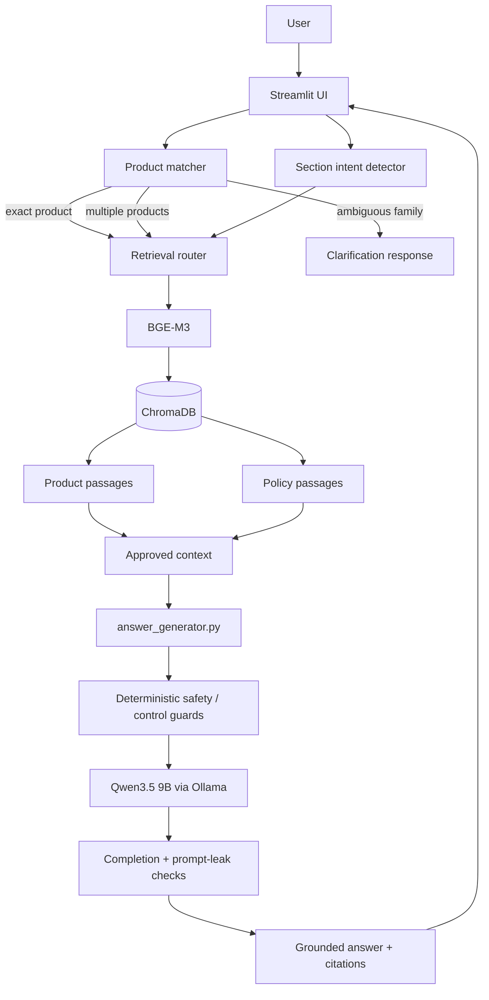

# EyeDropShop Brain — Architecture

## Purpose

EyeDropShop Brain is a local bilingual RAG prototype. It retrieves approved EyeDropShop content and constrains a local Qwen model to answer from that evidence.

## System architecture



## Responsibilities by module

### `app.py`

Presentation layer.

- language selector;
- question input;
- calls retrieval;
- calls answer generation;
- displays detected product;
- displays answer and retrieved sources.

### `product_matcher.py`

Structured product-name routing.

- normalizes product names and punctuation;
- detects exact product names;
- detects multiple named products;
- detects ambiguous product families such as `Refresh`;
- returns localized product titles.

### `retrieval.py`

Retrieval routing.

- detects section intent;
- filters by language;
- prioritizes exact product + exact section;
- supports multi-product comparisons;
- routes shipping/return questions to policy passages;
- uses BGE-M3 embeddings and ChromaDB semantic similarity as fallback.

### `answer_generator.py`

Generation and safety layer.

- formats approved retrieved evidence;
- enforces English/French answering;
- prevents unsupported claims;
- applies deterministic behavior for selected safety/control cases;
- avoids unsupported preservative-free inference;
- avoids personalized product recommendations;
- handles pediatric and personal-symptom questions;
- checks incomplete output;
- removes recognized prompt-leak lines.

### `evaluate_retrieval.py`

Regression test for structured retrieval.

Checks:

- exact product detection;
- expected product hit;
- expected section hit;
- target retrieval hit.

### `evaluate_answers.py`

Grounding evaluator.

Checks generated answers for:

- supported claims;
- partial claims;
- unsupported claims;
- citation correctness;
- prompt leakage;
- judge-format errors.

### `evaluate_robustness_behavior.py`

Behavior evaluator.

Checks whether a grounded answer also follows the intended behavior, such as:

- refusing unsupported information;
- avoiding medical recommendation;
- asking for clarification on ambiguity;
- not ranking products without evidence;
- respecting policy limits.

## Data path

```text
Shopify exports
    ↓
prepare_products.py
    ↓
prototype_data/products/products_30_bilingual.csv
    ↓
build_product_database.py
    ↓
ChromaDB product passages

Approved policy files
    ↓
converted policy text
    ↓
add_policies_to_database.py
    ↓
ChromaDB policy passages
```

## Runtime path

```text
Question
  ↓
product / intent routing
  ↓
BGE-M3 retrieval
  ↓
approved passages
  ↓
Qwen3.5 local generation
  ↓
citation + safety checks
  ↓
answer
```

## Privacy

The prototype is designed so that:

- embeddings are computed locally;
- ChromaDB is local;
- Qwen inference is local through Ollama;
- the Streamlit interface is local.

No external LLM API is required for the current prototype.
